# ObraFlow · Pedidos de compra com aprovação por alçada

Solução do desafio full-stack da ObraFlow ([enunciado original](https://github.com/ObraFlow/obraflow-case/blob/main/README.md)).
Pedidos de compra são cadastrados por obra, com N itens, e seguem uma cadeia de aprovadores definida por
faixas de valor configuráveis em cada obra. Só o aprovador da etapa atual decide; a rejeição exige motivo e
interrompe o fluxo; todo o histórico fica registrado.

- **Backend:** NestJS 12 + Prisma 7 + PostgreSQL 17 (`backend/`)
- **Frontend:** React 19 + Vite 8 + Mantine 9 + TanStack Query (`frontend/`)
- **Banco:** Postgres em Docker (`docker-compose.yml`)

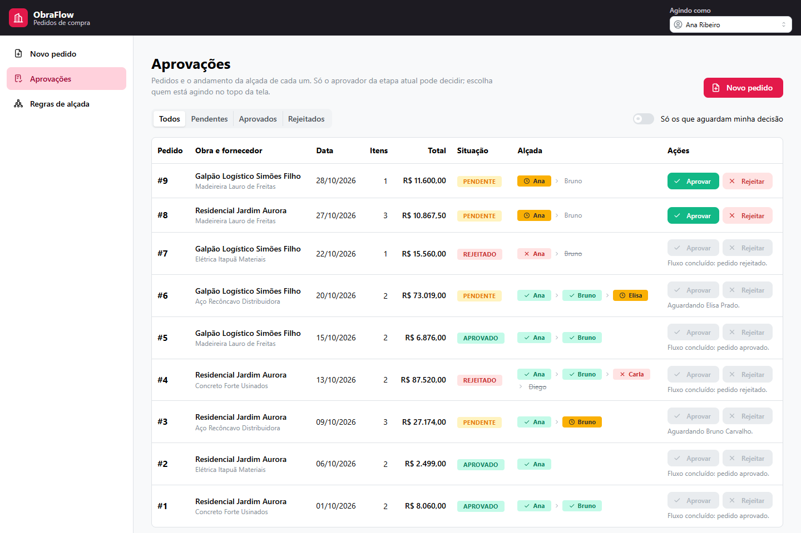

## Sumário

- [Como rodar do zero](#como-rodar-do-zero)
- [Telas](#telas)
- [Tecnologias e porquês](#tecnologias-e-porquês)
- [Como a alçada é modelada, calculada e persistida](#como-a-alçada-é-modelada-calculada-e-persistida)
- [Comunicação entre front e back](#comunicação-entre-front-e-back)
- [Consistência e integridade dos dados](#consistência-e-integridade-dos-dados)
- [Principais endpoints e payloads](#principais-endpoints-e-payloads)
- [Decisões técnicas](#decisões-técnicas)
- [O que mudaria em produção](#o-que-mudaria-em-produção)

---

## Como rodar do zero

**Pré-requisitos:** Node.js 22 ou superior (desenvolvido com o 24) e Docker com Docker Compose.
Nenhum serviço pago ou credencial externa é necessário.

```bash
# 1. Banco de dados (Postgres 17 na porta 5432)
docker compose up -d

# 2. API (http://localhost:3000, Swagger em http://localhost:3000/docs)
cd backend
cp .env.example .env
npm install
npx prisma generate         # gera o client tipado em src/generated/
npx prisma migrate deploy   # cria as tabelas
npm run seed                # dados de demonstração
npm run start:dev

# 3. Frontend (http://localhost:5173), em outro terminal
cd frontend
npm install
npm run dev
```

O front procura a API em `http://localhost:3000`. Para outro endereço, crie `frontend/.env` a partir de
`frontend/.env.example` (`VITE_API_URL`). A API libera CORS para a origem em `CORS_ORIGIN` (`backend/.env`).

### Dados de demonstração

`npm run seed` **recria** os dados do zero (apaga o que existir e reinicia os ids), então pode ser rodado quantas
vezes quiser e sempre termina no mesmo estado. Ele usa os próprios services da API, então cadeias, totais e
decisões passam pelas mesmas regras de quem usa a interface.

| Obra | Faixas (cumulativas) |
|---|---|
| Residencial Jardim Aurora | até R$ 5.000 → Ana · até R$ 50.000 → Bruno · acima → Carla, Diego |
| Galpão Logístico Simões Filho | até R$ 20.000 → Ana, Bruno · acima → Bruno, Elisa (Bruno aprova uma vez só) |
| Reforma da Escola Municipal Itinga | **sem regras**: mostra o bloqueio de pedidos sem faixa aplicável |

São 5 usuários (ids 1 a 5: Ana, Bruno, Carla, Diego, Elisa), 4 fornecedores e 9 pedidos em todos os estados:
pendente na 1ª, 2ª e 3ª etapa, aprovados, e rejeitados na 1ª e na 3ª etapa com motivo.

**Para experimentar:** escolha **Ana Ribeiro** em "Agindo como" (topo da tela) e aprove o #9; troque para
**Bruno Carvalho** e ele passa a ver o #9 e o #3 em "Só os que aguardam minha decisão". Elisa decide o #6.

### Testes

```bash
cd backend
npm test           # unitários: cadeia, decisão, dinheiro (27 testes)
npm run test:e2e   # e2e com Postgres real em um banco separado, obraflow_test (5 testes)

cd frontend
npm test           # unitários: cálculos, validação dos formulários, regras de exibição (27 testes)
```

Os testes e2e criam e migram o banco `obraflow_test` sozinhos e nunca tocam nos dados do seed. Entre eles está o
de concorrência: aprovações simultâneas da mesma etapa, em que só uma pode vencer.

---

## Telas

| | |
|---|---|
|  **Aprovações:** situação, alçada (✓ concluídos, da vez em destaque, próximos apagados) e ações que, quando bloqueadas, dizem o porquê. | 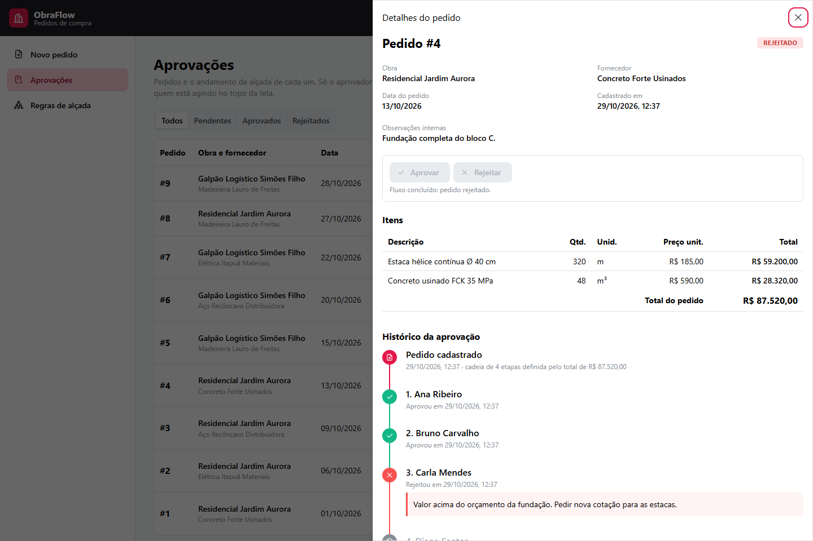 **Detalhe em drawer:** itens e histórico em timeline, com o motivo da rejeição. |
| 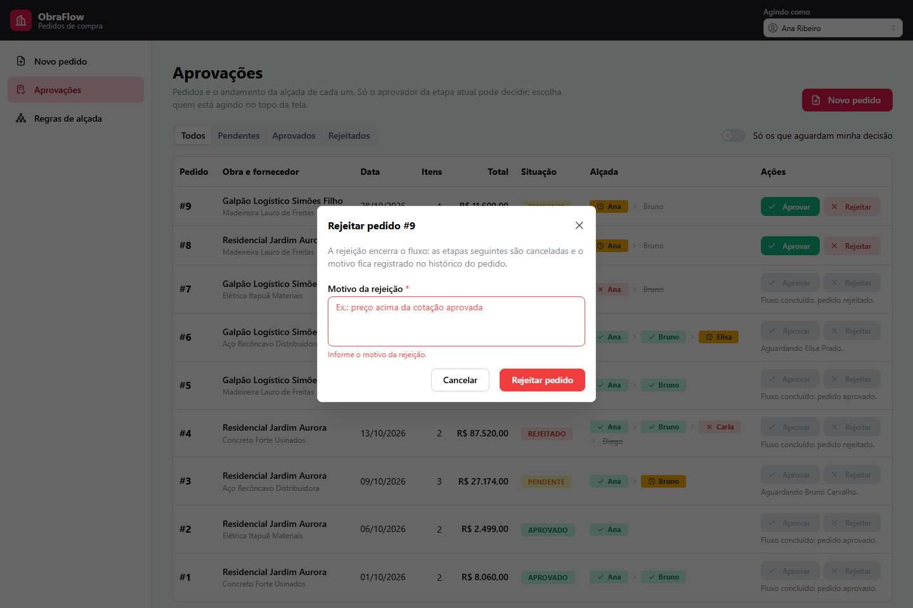 **Rejeição:** o motivo é validado antes do envio. | 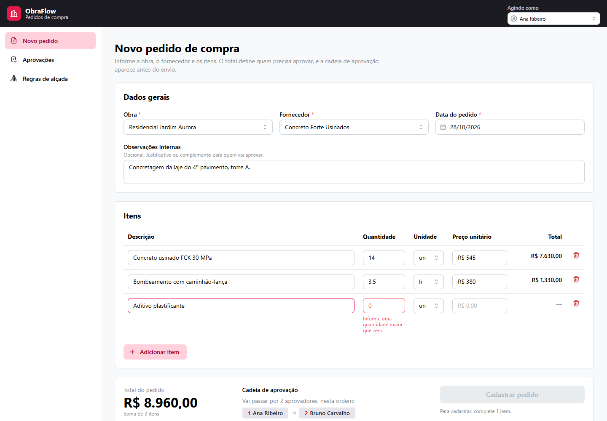 **Cadastro:** total por item e do pedido, erro na linha certa e prévia da cadeia. |
| 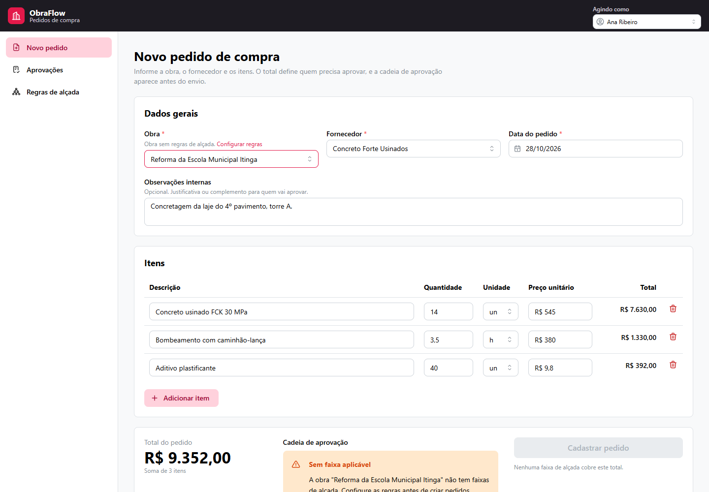 **Sem faixa aplicável:** aviso claro e envio bloqueado. | 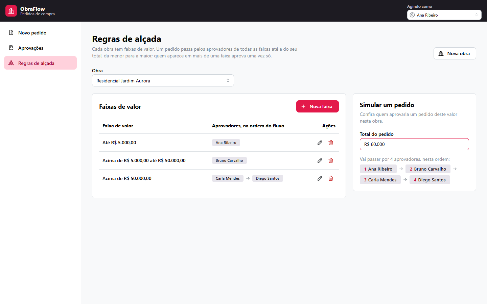 **Regras:** faixas por obra e simulador de valor. |
| 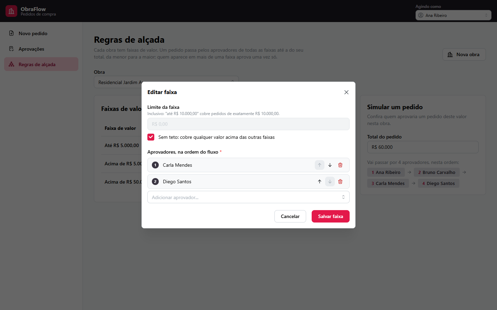 **Faixa:** limite inclusivo, sem teto e aprovadores reordenáveis. | 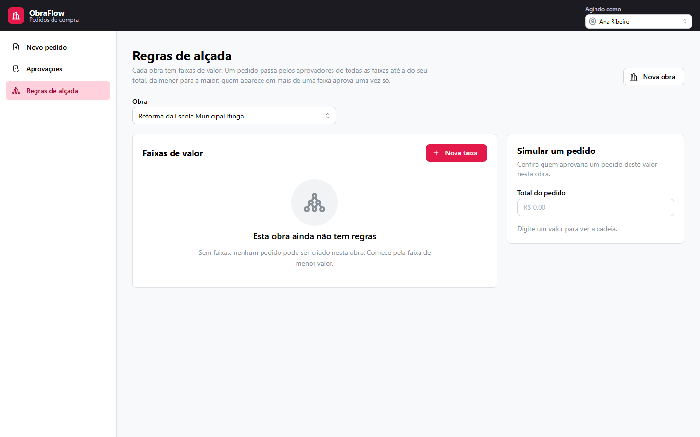 **Empty state** de obra sem regras. |
| 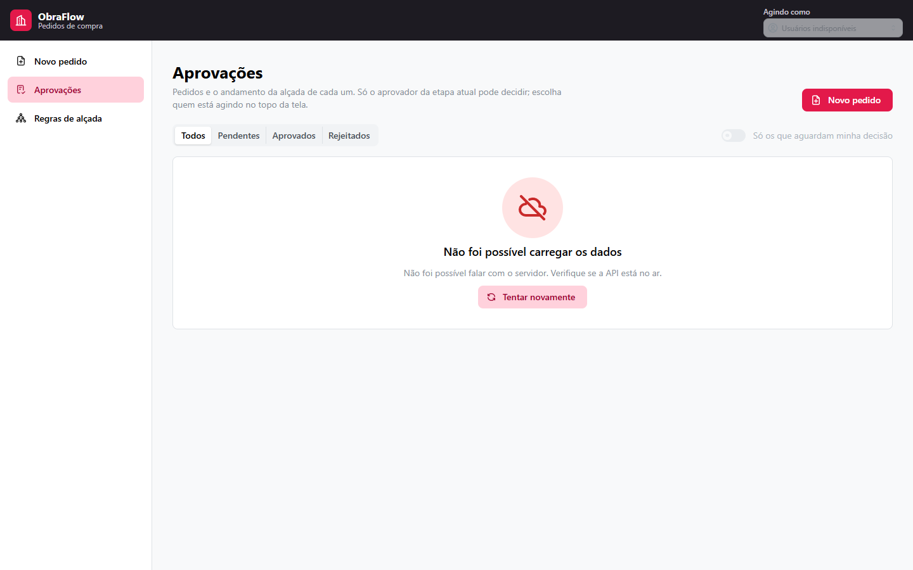 **API fora do ar:** estado de erro com "Tentar novamente". | 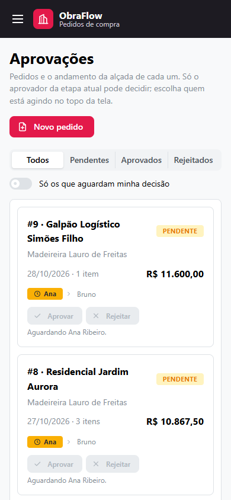 **Celular:** lista vira cartões; menu e "Agindo como" vão para o menu lateral. |

---

## Tecnologias e porquês

| Camada | Escolha | Por quê |
|---|---|---|
| API | **NestJS 12** | Módulos, injeção de dependência, pipes de validação e filtros de exceção prontos: o código fica organizado por domínio (obras, alçada, pedidos) sem eu ter de inventar essa estrutura. |
| Validação | **class-validator** nos DTOs | A regra de entrada fica declarada junto do formato do payload e alimenta o Swagger. |
| ORM | **Prisma 7** (driver adapter `pg`) | Schema declarativo com migrations versionadas e client tipado: o TypeScript acusa erro se uma query pede um campo que não existe. |
| Banco | **PostgreSQL 17** | Transações ACID, `NUMERIC` exato para dinheiro, índices parciais e o comportamento de lock de linha em que a trava de concorrência se apoia. |
| Dinheiro | **decimal.js** (back e front) | Float não representa 0,1 exatamente. A mesma biblioteca e o mesmo arredondamento nos dois lados fazem a prévia do front bater com o total que o back grava. |
| Front | **React + Vite + TypeScript** | Ecossistema padrão, build rápido e tipos compartilhando o contrato da API. |
| UI | **Mantine 9** | Componentes acessíveis prontos (tabela, drawer, modal, timeline, empty state) e formulários com validação por campo, inclusive em listas (`itens.0.quantidade`). |
| Estado do servidor | **TanStack Query** | Cache, loading/erro por consulta, retry e invalidação depois de mutações; nada de estado global feito à mão. |
| Rotas | **React Router 8** | Filtros e o pedido aberto ficam na URL (`/aprovacoes?status=PENDENTE&pedido=3`), então dá para compartilhar e voltar. |
| Testes | **Vitest** + **Supertest** | Mesmo runner nos dois projetos; os e2e usam Postgres real porque concorrência não se testa com mock. |
| Lint/format | **oxlint** + **Prettier** | oxlint com regras type-aware (por exemplo, promises sem `await`). |

---

## Como a alçada é modelada, calculada e persistida

### Modelo de dados

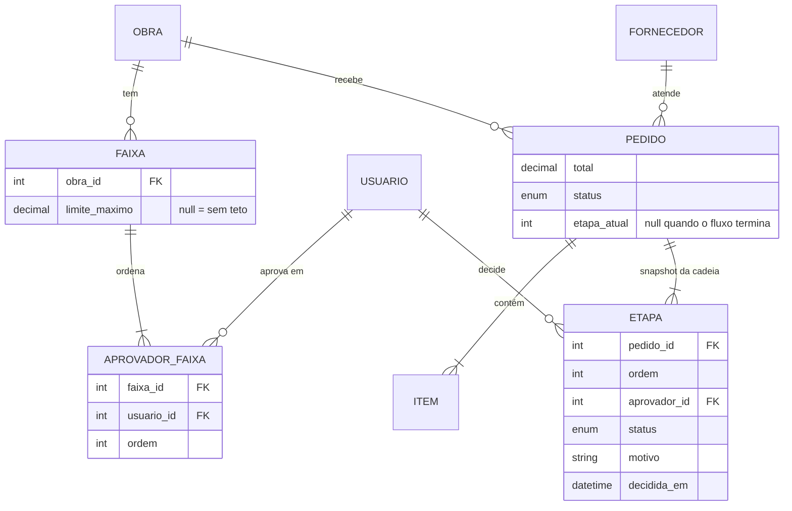

- **Regra (configurável):** `faixas` por obra, cada uma com `limite_maximo` (null = sem teto) e
  `aprovadores_faixa`, a tabela que liga faixa e usuário guardando a **ordem** dentro da faixa.
- **Execução (snapshot):** `etapas` por pedido, uma por aprovador, com `ordem`, `status`
  (`PENDENTE`, `APROVADA`, `REJEITADA`, `CANCELADA`), `motivo` e `decidida_em`. O pedido guarda `total`,
  `status` e `etapa_atual` (a ordem da etapa da vez; null quando o fluxo termina).

### Cálculo: modelo cumulativo

A cadeia é formada pelas faixas da obra em **ordem crescente de limite** (a sem teto por último), **até e
incluindo a faixa em que o total cai**; dentro de cada faixa, pela ordem configurada. Exemplo com a obra Aurora:

| Total | Faixa em que cai | Cadeia |
|---|---|---|
| R$ 4.000,00 | até R$ 5.000 | Ana |
| R$ 5.000,00 | até R$ 5.000 (**"até" inclui o limite**) | Ana |
| R$ 27.174,00 | até R$ 50.000 | Ana → Bruno |
| R$ 87.520,00 | sem teto | Ana → Bruno → Carla → Diego |

É o mesmo comportamento do exemplo do enunciado: até R$ 10.000 → João; acima → Amanda. Um pedido de R$ 12.500
passa por João e depois por Amanda.

- **Aprovador repetido** em faixas diferentes fica só na **primeira ocorrência** (no Galpão, acima de
  R$ 20.000 a cadeia é Ana → Bruno → Elisa, e não Ana → Bruno → Bruno → Elisa).
- **Sem faixa aplicável** (obra sem regras, ou total acima do maior limite sem faixa sem teto): o pedido **não é
  criado** e a API responde **422** `SEM_FAIXA_APLICAVEL` com a explicação. O front descobre isso antes do envio
  pela prévia (`GET /obras/:id/cadeia?total=`), que responde 200 com `aplicavel: false` e desabilita o botão.

O cálculo é uma **função pura** ([backend/src/alcada/cadeia.ts](backend/src/alcada/cadeia.ts)): recebe faixas e
total e devolve `{ordem, aprovadorId}[]` ou o motivo de não haver faixa, sem banco e sem framework. Por isso é
testada isoladamente e reaproveitada pela criação do pedido, pela prévia e pelo seed.

### Persistência: snapshot

Na criação, a cadeia calculada é **copiada para `etapas`**, e o pedido nasce com `etapa_atual = 1`. Daí em diante
o pedido nunca mais consulta as faixas: editar ou remover regras **não altera pedidos existentes** (há um teste
e2e para isso). As etapas em ordem são também o **histórico**: quem decidiu, quando e com qual motivo.

Nada é apagado: rejeitar marca a etapa como `REJEITADA`, as seguintes como `CANCELADA` e o pedido como
`REJEITADO`. A última aprovação marca o pedido como `APROVADO`. Nos dois casos `etapa_atual` vira null.

---

## Comunicação entre front e back

- **REST + JSON.** O front usa um cliente `fetch` fino ([frontend/src/api/cliente.ts](frontend/src/api/cliente.ts))
  e hooks do TanStack Query por recurso ([frontend/src/api/consultas.ts](frontend/src/api/consultas.ts)). Depois
  de cada mutação, as consultas afetadas são invalidadas e a tela se atualiza sozinha.
- **Quem está agindo:** não há login (veja [Decisões técnicas](#decisões-técnicas)). O usuário escolhido em
  "Agindo como" vai no header **`X-Usuario-Id`** nas decisões; sem ele, a API responde 401.
- **Dinheiro e quantidades trafegam como string** (`"12500.00"`, `"2.5"`). Número em JSON vira float no
  JavaScript e perde precisão.
- **O back não confia no front:** totais enviados são descartados (o `ValidationPipe` remove campos fora do DTO) e
  recalculados no servidor.
- **Erros em formato único.** Toda resposta de erro tem o mesmo corpo; erros de validação trazem o caminho do
  campo, que o front usa para marcar o erro no input certo, inclusive dentro da tabela de itens:

```json
{
  "statusCode": 400,
  "codigo": "VALIDACAO",
  "mensagem": "Há campos inválidos na requisição.",
  "detalhes": [{ "campo": "itens.0.quantidade", "mensagem": "A quantidade deve ser um número maior que zero, com até 3 casas decimais." }],
  "caminho": "/pedidos",
  "dataHora": "2026-10-28T14:00:00.000Z"
}
```

---

## Consistência e integridade dos dados

**Transações.**
- **Criar pedido:** em uma transação, lê as regras, monta a cadeia e grava pedido, itens e etapas. Se não houver
  faixa, nada é gravado. Usa `RepeatableRead` para todas as leituras das regras enxergarem o mesmo estado, mesmo
  que alguém edite a faixa no meio. Como só há `INSERT`, esse nível não gera conflito.
- **Editar faixa:** os aprovadores são apagados e recriados na mesma transação da faixa (evita colisão com a
  unique de ordem ao trocar posições e ninguém lê a faixa sem aprovadores).

**Trava otimista nas decisões.** Duas pessoas (ou dois cliques) podem tentar decidir a mesma etapa ao mesmo
tempo. A decisão roda numa transação que, depois de validar quem pode decidir, faz:

```ts
const { count } = await tx.pedido.updateMany({
  where: { id, status: 'PENDENTE', etapaAtual: etapa.ordem }, // só casa se ninguém decidiu antes
  data: plano.pedido,
});
if (count === 0) throw new ErroApi(409, 'DECISAO_CONCORRENTE', '...');
```

A primeira transação pega o lock da linha do pedido; a segunda espera. Quando a primeira faz commit, o Postgres
reavalia o `WHERE` da segunda na versão nova da linha (`etapaAtual` já mudou), nenhuma linha é afetada e a API
responde **409**. Isso depende do nível `READ COMMITTED`, o padrão, que foi mantido de propósito: em
`RepeatableRead` a segunda transação abortaria com erro de serialização. O teste e2e dispara 10 aprovações
simultâneas da mesma etapa e confere que exatamente uma vence e que a etapa seguinte não é pulada.

**Ordem da alçada.** Só o aprovador da etapa atual decide (403 `FORA_DA_VEZ` caso contrário); pedido concluído
responde 409 `FLUXO_CONCLUIDO`; rejeição sem motivo responde 400. Essas regras ficam numa função pura
([backend/src/pedidos/decisao.ts](backend/src/pedidos/decisao.ts)) com testes unitários.

**Constraints no banco**, a última barreira quando duas requisições passam juntas pelas validações do service:
- `UNIQUE (faixa_id, ordem)` e `UNIQUE (faixa_id, usuario_id)` nos aprovadores; `UNIQUE (pedido_id, ordem)` nas etapas.
- `UNIQUE (obra_id, limite_maximo)` impede limites repetidos. Como no Postgres `NULL ≠ NULL`, essa unique aceitaria
  duas faixas sem teto; por isso a migration cria à mão um **índice parcial**:
  `CREATE UNIQUE INDEX faixas_obra_sem_teto_key ON faixas(obra_id) WHERE limite_maximo IS NULL`.
- Chaves estrangeiras em todas as relações e índices nas colunas usadas em filtros (`pedidos.status`,
  `etapas(aprovador_id, status)`, chaves estrangeiras).

**Dinheiro exato.** Colunas `NUMERIC(14,2)` (quantidade `NUMERIC(12,3)`), `Decimal` no código, total do item
arredondado para 2 casas (half-up) e total do pedido = soma dos itens, **persistido**: é o valor que escolheu a
alçada e precisa continuar igual mesmo que a regra de arredondamento mude um dia.

---

## Principais endpoints e payloads

Documentação interativa completa em **http://localhost:3000/docs** (Swagger; use **Authorize** para informar o
`X-Usuario-Id`).

| Método | Rota | O que faz |
|---|---|---|
| `GET` / `POST` | `/obras` | Lista (com `quantidadeFaixas`) / cria `{ nome }` |
| `GET` / `POST` | `/usuarios` | Lista / cria `{ nome, email }` |
| `GET` / `POST` | `/fornecedores` | Lista / cria `{ nome, cnpj? }` |
| `GET` | `/obras/:obraId/faixas` | Faixas da obra, limite crescente e a sem teto por último |
| `POST` | `/obras/:obraId/faixas` | Cria faixa `{ limiteMaximo, aprovadorIds }` |
| `PUT` | `/faixas/:id` | Substitui limite e lista **ordenada** de aprovadores (adicionar, remover, reordenar) |
| `DELETE` | `/faixas/:id` | Remove a faixa (pedidos existentes não mudam) |
| `GET` | `/obras/:obraId/cadeia?total=12500.00` | Prévia da cadeia que esse total geraria |
| `POST` | `/pedidos` | Cria pedido com itens e cadeia |
| `GET` | `/pedidos?status=PENDENTE&aprovadorId=2` | Lista; `aprovadorId` = só os que estão na vez dessa pessoa |
| `GET` | `/pedidos/:id` | Detalhe com itens e etapas |
| `POST` | `/pedidos/:id/aprovar` | Aprova a etapa atual (header `X-Usuario-Id`) |
| `POST` | `/pedidos/:id/rejeitar` | Rejeita com `{ motivo }` (header `X-Usuario-Id`) |

**Criar faixa.** `limiteMaximo: null` cria a faixa sem teto; a ordem do array é a ordem do fluxo.

```json
POST /obras/1/faixas
{ "limiteMaximo": "50000.00", "aprovadorIds": [2, 1] }
```

**Prévia da cadeia.**

```json
GET /obras/1/cadeia?total=27174.00
{ "aplicavel": true, "motivo": null, "mensagem": null,
  "etapas": [{ "ordem": 1, "aprovador": { "id": 1, "nome": "Ana Ribeiro" } },
             { "ordem": 2, "aprovador": { "id": 2, "nome": "Bruno Carvalho" } }] }

GET /obras/3/cadeia?total=100.00
{ "aplicavel": false, "etapas": [], "motivo": "OBRA_SEM_FAIXAS",
  "mensagem": "A obra \"Reforma da Escola Municipal Itinga\" não tem faixas de alçada. Configure as regras antes de criar pedidos." }
```

**Criar pedido.** Sem totais: o back calcula.

```json
POST /pedidos
{
  "obraId": 1,
  "fornecedorId": 1,
  "dataPedido": "2026-10-28",
  "observacoes": "Concretagem da laje do 4º pavimento.",
  "itens": [
    { "descricao": "Concreto usinado FCK 30 MPa", "quantidade": "14", "unidade": "M3", "precoUnitario": "545.00" },
    { "descricao": "Bombeamento com caminhão-lança", "quantidade": "3.5", "unidade": "H", "precoUnitario": "380.00" }
  ]
}
```

Resposta `201` com o pedido detalhado (`total: "8960.00"`, `etapaAtual: 1`, `itens` com o total de cada um e
`etapas` com a cadeia). Unidades: `UN`, `KG`, `M`, `M2`, `M3`, `H`.

**Decidir.**

```bash
curl -X POST localhost:3000/pedidos/9/aprovar -H "X-Usuario-Id: 1"
curl -X POST localhost:3000/pedidos/3/rejeitar -H "X-Usuario-Id: 2" \
     -H "Content-Type: application/json" -d '{"motivo":"Preço acima da cotação aprovada."}'
```

| Situação | Status | `codigo` |
|---|---|---|
| Header `X-Usuario-Id` ausente | 401 | `USUARIO_NAO_IDENTIFICADO` |
| Quem age não é o aprovador da etapa atual | 403 | `FORA_DA_VEZ` |
| Rejeição sem motivo | 400 | `VALIDACAO` |
| Pedido inexistente | 404 | `NAO_ENCONTRADO` |
| Pedido já aprovado ou rejeitado | 409 | `FLUXO_CONCLUIDO` |
| Outra decisão entrou ao mesmo tempo | 409 | `DECISAO_CONCORRENTE` |
| Nenhuma faixa cobre o total (criação) | 422 | `SEM_FAIXA_APLICAVEL` |

---

## Decisões técnicas

Usei o Claude Code como assistente de desenvolvimento; as decisões de modelagem e de regra de negócio estão justificadas abaixo.

- **Modelo cumulativo de alçada.** Valores maiores passam por mais gente, e quem aprova as faixas menores continua
  no fluxo, como no exemplo do enunciado (João, depois Amanda). A alternativa, usar só os aprovadores da faixa em
  que o total cai, faria um pedido grande pular quem conhece a obra no dia a dia.
- **Duplicata mantém a primeira ocorrência.** A pessoa aprova no nível mais baixo em que aparece; aprovar duas
  vezes o mesmo pedido não acrescenta controle nenhum.
- **"Até X" inclui X.** É a leitura natural de "até R$ 10.000,00" e evita a dúvida de onde cai o valor exato do limite.
- **Sem faixa aplicável bloqueia a criação (422).** Criar um pedido sem aprovador deixaria um pedido que ninguém
  pode decidir, e aprovar automaticamente seria um furo de controle. O front avisa antes, pela prévia.
- **Snapshot da cadeia em `etapas`.** Quem precisa aprovar é decidido quando o pedido nasce. Recalcular a partir
  das regras atuais mudaria pedidos em andamento sempre que alguém editasse uma faixa e apagaria o histórico.
- **`etapa_atual` no pedido em vez de um status "aguardando" na etapa.** A etapa da vez é derivável (ordem =
  `etapa_atual`); guardar a mesma informação em dois lugares abriria espaço para os dois discordarem. E a trava
  de concorrência precisa de um único campo para comparar.
- **Total persistido.** Poderia ser calculado somando itens, mas é o valor que definiu a cadeia: fica gravado como
  fato, e a listagem não precisa agregar itens.
- **Trava otimista com `updateMany` condicional** em vez de `SELECT ... FOR UPDATE`. Funciona com a API normal do
  Prisma, sem SQL cru, segura o lock só durante o `UPDATE` e transforma o conflito num 409 claro. Alternativas
  consideradas: lock pessimista (precisa de `$queryRaw` e segura o lock desde a leitura) e coluna `versao`
  (equivalente aqui, porque `etapa_atual` já muda a cada decisão).
- **Regras de domínio em funções puras** (`montarCadeia`, `planejarDecisao`). O service só lê, chama a função e
  grava; a regra é testada sem banco e sem mock.
- **Sem autenticação; `X-Usuario-Id` + seletor "Agindo como".** Login não faz parte do escopo, e com o seletor quem
  avalia troca de papel em um clique para ver o fluxo inteiro. O header deixa a API pronta para receber a
  identidade de um middleware de autenticação de verdade sem mudar os services. **Em produção, isso precisa ser
  autenticação real** (veja abaixo).
- **Valores decimais como string na API** e `decimal.js` com half-up nos dois lados: a prévia do front e o total
  gravado são sempre iguais.
- **Índice parcial escrito à mão na migration.** O Prisma não expressa `WHERE` em índice. Fica registrado no
  `CLAUDE.md` que, se uma migration futura gerar `DROP` desse índice, a linha deve ser removida.
- **Seed via services**, e não com inserts diretos: os dados de demonstração não podem contradizer as regras.
- **Erros com `codigo` estável além da mensagem.** O front decide o que fazer pelo código (por exemplo, mapear
  `detalhes` para os campos) e a mensagem fica livre para ser amigável.

---

## O que mudaria em produção

1. **Login de verdade com token.** Hoje quem age é escolhido numa lista no topo da tela. Em produção a pessoa
   entraria com seu usuário, a API saberia quem ela é por um token que não dá para falsificar, e cada um só
   faria o que pode (por exemplo, só algumas pessoas mudam as regras).
2. **Registrar também quem alterou as regras e quando.** O histórico de cada pedido já fica gravado; faltam as
   mudanças nas faixas e nos aprovadores, para saber depois quem mudou o quê.
3. **Avisar o próximo aprovador.** Mandar e-mail ou mensagem quando o pedido chega à vez de alguém, sem atrasar
   a resposta da tela e sem perder o aviso se o envio falhar.
4. **Paginação.** Mostrar os pedidos em páginas, com filtro por obra e período, e carregar cada tela só quando
   ela for aberta, para o sistema continuar rápido com milhares de pedidos.
5. **Logs e monitoramento.** Registrar o que acontece na API e acompanhar erros e lentidão, para descobrir um
   problema antes de o usuário reclamar.
6. **Rodar testes automaticamente a cada push.** Lint, testes e build rodando sozinhos no GitHub a cada envio de
   código, para nada quebrado chegar à versão publicada.

---

## Estrutura

```
backend/
  prisma/schema/          schema multi-arquivo (um model por arquivo) e migrations
  src/alcada/             cadeia (função pura), faixas e prévia
  src/pedidos/            criação, listagem, decisão (função pura) e trava otimista
  src/obras|usuarios|fornecedores/
  src/comum/              erro padronizado, validação, dinheiro, header X-Usuario-Id
  src/seed/               seed idempotente
  test/                   e2e com banco obraflow_test
frontend/
  src/api/                cliente fetch, tipos e hooks do TanStack Query
  src/comum/              dinheiro, rótulos e regras de exibição (testados)
  src/componentes/        layout, alçada, prévia da cadeia, estados de erro
  src/paginas/            novo-pedido, aprovacoes, regras
docs/screenshots/
```
